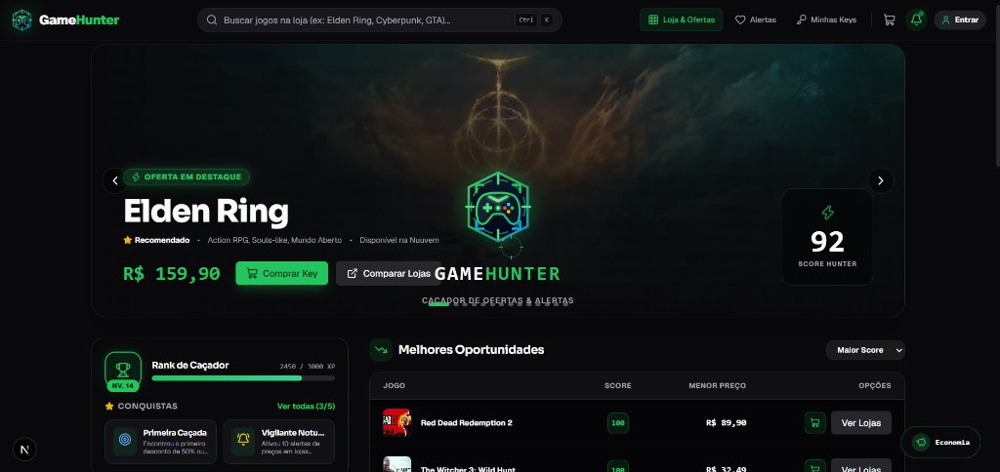
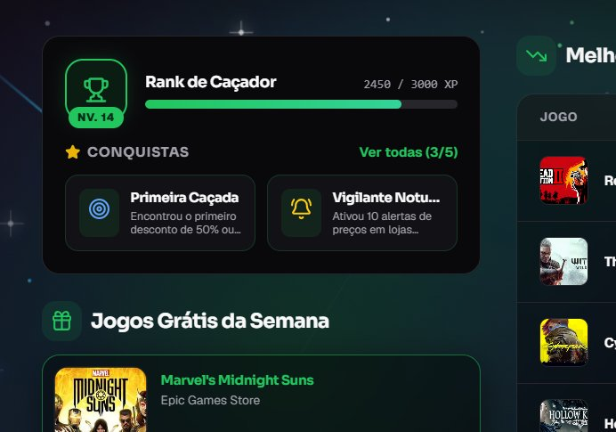
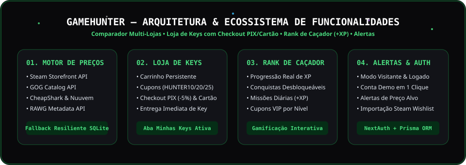

<div align="center">
  
  <h1>GameHunter — Plataforma de Venda de Keys, Comparação de Preços & Alertas</h1>
  <p>
    <strong>Repositório Oficial:</strong> <a href="https://github.com/Lucas-715/GAMEHunter">https://github.com/Lucas-715/GAMEHunter</a>
  </p>
</div>

---

O **GameHunter** é uma plataforma completa para comercialização de chaves digitais (*Keys*), comparação de preços em tempo real entre lojas oficiais, gamificação de caçadores de ofertas e monitoramento inteligente de descontos para jogos de PC.

A identidade visual do projeto traz a logo oficial **Green Skull Headset** (`public/logo.png`), acompanhada de **efeitos interativos de Universo no fundo** (nebulosas cósmicas, campo estelar 3D com paralaxe ao mover o mouse, constelações dinâmicas, poeira estelar e estrelas cadentes).

---

## 📸 Imagens do Sistema

### Visão Geral da Plataforma (Dashboard, Ofertas em Destaque & Oportunidades)


### Sistema de Gamificação Interativo (Rank de Caçador, Conquistas & Fundo Estelar)


### Arquitetura de Módulos do Sistema


---

## 👨‍💻 Autoria e Declaração sobre o Uso de Inteligência Artificial

Este projeto foi idealizado, estruturado e desenvolvido pelo desenvolvedor responsável pelo repositório (**Lucas**), utilizando ferramentas de Inteligência Artificial como apoio técnico pontual durante o ciclo de desenvolvimento:

1. **Escopo de Uso da IA:**
   - **Auxílio na Conexão com as APIs Externas:** Suporte na implementação dos adaptadores de comunicação e rotinas de tratamento de *timeout*/contingência para as APIs públicas das lojas de jogos (Steam, GOG, CheapShark, Nuuvem e RAWG).
   - **Refinamento Visual e de Design:** Apoio pontual no aprimoramento estético de componentes de interface e efeitos visuais interativos de fundo.
2. **Desenvolvimento e Validação Integral pelo Desenvolvedor:**
   - **Todo o restante do sistema** — incluindo regras de negócio, fluxo de e-commerce, estrutura de rotas, modelagem de dados e integração entre módulos — **foi desenvolvido pelo próprio desenvolvedor com o auxílio da IA**.
   - **100% do código, ajustes e sugestões gerados com o auxílio da IA foram rigorosamente revisados, testados e validados pelo desenvolvedor**, garantindo total domínio técnico, qualidade e integridade do funcionamento da aplicação.

---

## ⚠️ Nota Técnica Importante: Funcionamento do Sistema vs. Instabilidade das APIs Externas

> **O sistema GameHunter é 100% funcional de ponta a ponta.** Todas as rotas de backend, banco de dados, autenticação, carrinho de compras, checkout, geração de chaves, Rank de Caçador, filtros, wishlist e alertas estão integralmente implementados e operacionais.

### Por que algumas cotações ou links de APIs externas de jogos apresentam limitações?
O projeto implementa o consumo real de múltiplas APIs e fontes públicas do mercado de jogos (`lib/prices/adapters/` e `lib/search-engine/`). No entanto, **as APIs públicas fornecidas pelas plataformas de jogos possuem restrições e instabilidades externas que fogem ao controle da aplicação**:

1. **Steam Storefront API (`store.steampowered.com/api/storesearch` e `appdetails`):**
   - Não é uma API comercial aberta para agregadores; a Valve aplica *rate-limiting* severo por IP e bloqueia frequentemente requisições automatizadas.
2. **Nuuvem (`nuuvem.com/br-pt/catalog/search`):**
   - Não disponibiliza API pública aberta. O coletor (`lib/scrapers/nuuvem.ts`) utiliza *web scraping* com `cheerio`, porém o firewall da **Cloudflare** na Nuuvem bloqueia requisições automatizadas com erro `HTTP 403 Forbidden`.
3. **CheapShark API (`cheapshark.com/api/1.0/games`):**
   - Utilizada nos adaptadores da *Green Man Gaming* e *GamersGate*, fornece preços originalmente em **USD (Dólar)** sem suporte nativo à precificação regional brasileira (BRL), exigindo conversão cambial via `ExchangeRate-API` (`lib/currency.ts`).
4. **GOG Catalog API (`catalog.gog.com/v1/catalog`) & RAWG API (`api.rawg.io`):**
   - Sofrem oscilações de latência e exigem chaves de API com limite restrito de requisições mensais.

### 🛡️ Solução de Contingência Implementada:
Para que a experiência do usuário e o funcionamento do sistema **nunca sejam prejudicados por quedas, timeouts ou bloqueios 403 das APIs externas**, foi implementada uma **Arquitetura de Contingência Multi-Camadas**:
- Todas as chamadas às APIs externas são executadas com `AbortController` (timeout controlado por adaptador).
- Quando uma API externa responde normalmente, os preços e metadados ao vivo são exibidos e salvos no histórico do banco (`Prisma`).
- Caso a API externa falhe, demore ou bloqueie a conexão, o `PriceAggregator` e o `SearchEngine` acionam automaticamente o **Fallback Resiliente** (usando os dados persistidos no banco SQLite/Prisma e no catálogo local estruturado), gerando URLs diretas e funcionais para cada loja (`Steam`, `Nuuvem`, `GOG`, `Green Man Gaming` e `GamersGate`).

---

## ✨ Funcionalidades Completas do Sistema

### 1. 🏆 Rank de Caçador e Sistema de Gamificação (`GamificationWidget`)
- **Progressão Real de Nível e XP:** A barra de XP e o nível do Caçador evoluem em tempo real conforme você interage com o sistema (adicionando Keys ao carrinho, criando alertas de preço, resgatando jogos grátis ou completando missões).
- **Conquistas Desbloqueáveis com Bônus de XP:** Clique sobre qualquer conquista no card lateral ou em **"Ver todas"** para resgatar recompensas de XP (`+200 XP` a `+400 XP`) ou completar conquistas pendentes.
- **Missões Diárias Interativas:** Conclua missões rápidas direto pelo painel para ganhar XP extra imediatamente.
- **Recompensas VIP por Nível:** Conforme seu nível sobe, você desbloqueia e copia com 1 clique cupons exclusivos para usar no carrinho (`HUNTER10`, `HUNTER20` e o cupom VIP `HUNTER25` de 25% OFF ao atingir o Nível 15).

### 2. 🛒 Sistema de Venda de Jogos (Carrinho, Checkout & Entrega de Keys)
- **Carrinho de Compras Persistente:** Adicione qualquer jogo do catálogo ou da busca ao carrinho com 1 clique.
- **Cupons de Desconto Funcionais:** Aplique cupons promocionais diretamente no carrinho:
  - `HUNTER10` (10% de desconto)
  - `PRIMEIRACOMPRA` (15% de desconto)
  - `HUNTER20` (20% de desconto)
  - `HUNTER25` (25% de desconto — desbloqueável no Rank de Caçador Nv. 15)
- **Checkout Transparente:**
  - **PIX Instantâneo:** Concede +5% de desconto extra, gera QR Code e código *PIX Copia e Cola*.
  - **Cartão de Crédito:** Simulação completa com validação de campos e parcelamento em até 3x sem juros.
- **Biblioteca / Minhas Keys (`Orders`):** Após confirmar a compra, o sistema gera automaticamente a **Chave de Ativação Digital (`XXXX-YYYY-ZZZZ-WWWW`)**, permitindo revelar a key, copiá-la para a área de transferência e abrir a página de ativação da Steam.

### 3. 🔐 Sistema de Login Flexível (Com ou Sem Login Obrigatório)
- **Modo Visitante Completo:** Visitantes podem pesquisar jogos, comparar preços, subir de nível no Rank de Caçador, adicionar itens ao carrinho, finalizar compras, criar alertas e favoritar jogos sem obrigatoriedade de login.
- **Autenticação Completa (`NextAuth` + `bcrypt` + `Prisma`):**
  - Cadastro de novos usuários (`/api/auth/register`) e login seguro (`/api/auth/[...nextauth]`).
  - **Botão "Entrar com Conta Demo (1 Clique)"** no modal de perfil (`demo@gamehunter.com` / `123456`) para testes imediatos.
  - Painel do usuário com configurações de **Região/Moeda (BRL, USD, EUR)**, **Preferências de Notificação** e **Conexão de Lojas**.

### 4. 📊 Comparador de Preços, Score Hunter & Alertas
- **Score Hunter (0 a 100):** Algoritmo que avalia o quão vantajosa é a oferta atual em relação ao menor preço histórico (*Historical Low*) e ao preço cheio de tabela.
- **Comparativo entre Lojas Oficiais:** Lista lado a lado as cotações da Steam, Nuuvem, GOG, Green Man Gaming e GamersGate.
- **Gerenciador de Alertas & Importador da Steam:** Crie alertas personalizados por preço alvo, filtre por *Todos*, *Ativos* ou *Atingidos*, edite valores inline e importe sua Wishlist da Steam.

---

## 🛠️ Stack Tecnológica e Rotas de API

- **Frontend:** Next.js 16 (App Router & Turbopack), React 19, TypeScript, Tailwind CSS, Lucide Icons.
- **Backend (Next.js Route Handlers):**
  - `GET /api/games/dashboard` — Destaques, oportunidades e cache de cotações.
  - `GET /api/games/search?q=...` — Motor de busca híbrido (Banco Local + Steam API + CheapShark API).
  - `GET /api/games/[id]` — Detalhes do jogo, agregação ao vivo de lojas e enriquecimento RAWG.
  - `GET | POST | PATCH | DELETE /api/alerts` — CRUD completo de alertas de preço.
  - `GET | POST | DELETE /api/wishlist` — Gerenciamento da lista de desejos do usuário.
  - `POST /api/auth/register` & `/api/auth/[...nextauth]` — Registro e autenticação JWT.
  - `GET /api/cron/update-prices` — Rotina automatizada para atualização de histórico de preços e disparo de notificações (`Resend`).
- **Banco de Dados:** Prisma ORM + SQLite (`prisma/dev.db` já pré-populado e pronto para uso local).

---

## 🚀 Como Executar o Projeto Localmente

### 1. Clone o repositório
```bash
git clone https://github.com/Lucas-715/GAMEHunter.git
cd GAMEHunter
```

### 2. Instale as dependências
```bash
npm install
```

### 3. Variáveis de Ambiente (`.env`)
Crie um arquivo `.env` na raiz do projeto contendo:
```env
DATABASE_URL="file:./dev.db"
CRON_SECRET="super_secret_cron_token_123"
NEXTAUTH_SECRET="super_secret_for_development"
NEXTAUTH_URL="http://localhost:3000"
```

### 4. Gere o cliente Prisma
```bash
npx prisma generate
```

### 5. Inicie o servidor de desenvolvimento
```bash
npm run dev
```
Acesse no navegador: **[http://localhost:3000](http://localhost:3000)**
