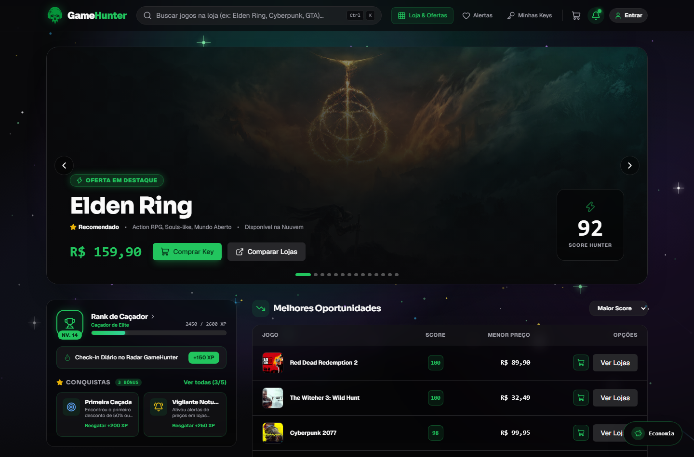
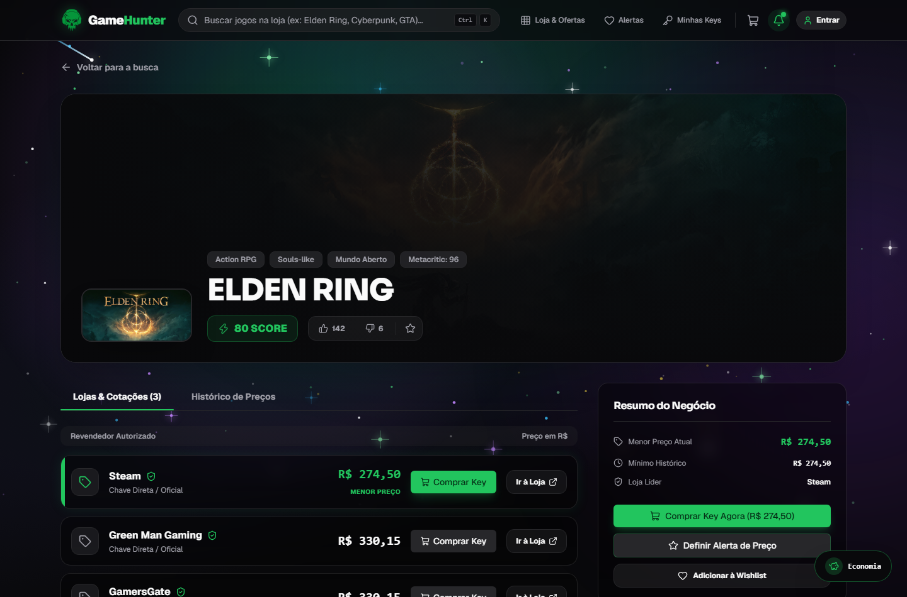
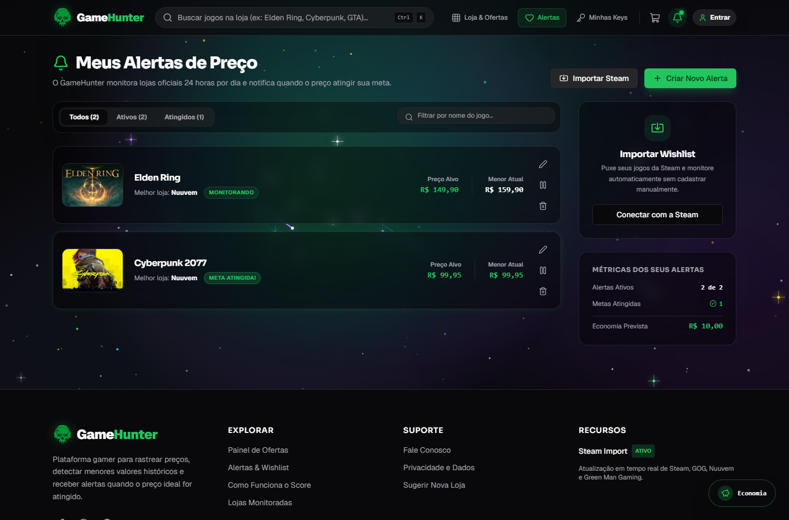

<div align="center">
  
  <h1>GameHunter — Plataforma de Venda de Keys, Comparação de Preços & Alertas</h1>
  <p>
    <strong>Repositório Oficial:</strong> <a href="https://github.com/Lucas-715/GAMEHunter">https://github.com/Lucas-715/GAMEHunter</a> •
    <strong>Acesse Online:</strong> <a href="https://gamehunter.lucas-s-almeida715.workers.dev/">https://gamehunter.lucas-s-almeida715.workers.dev/</a>
  </p>
  <p>
    
    
  </p>
</div>

---

## 🚧 Status do Projeto: Sistema em Desenvolvimento

> **Atenção:** O **GameHunter** é um **sistema em desenvolvimento (protótipo avançado / MVP acadêmico e experimental)**. Apesar de todos os fluxos, telas, banco de dados, carrinho, geração de chaves e rotas da aplicação estarem **100% funcionais e navegáveis de ponta a ponta para testes e demonstração**, o projeto **ainda não está pronto para uso comercial em produção final** (operações financeiras reais de gateway bancário e contratos comerciais de distribuição de chaves encontram-se simulados para fins de desenvolvimento e validação da plataforma).

---

O **GameHunter** é uma plataforma para comercialização de chaves digitais (*Keys*), comparação de preços em tempo real entre lojas oficiais, gamificação de caçadores de ofertas e monitoramento inteligente de descontos para jogos de PC.

A identidade visual do projeto traz a logo oficial **Green Skull Headset** (`public/logo.png`), acompanhada de **efeitos interativos de Universo no fundo** (nebulosas cósmicas, campo estelar 3D com paralaxe ao mover o mouse, constelações dinâmicas, poeira estelar e estrelas cadentes).

---

## 📸 Imagens do Sistema Atualizado em Execução

### 1. Visão Geral da Plataforma (Dashboard Atualizado, Logo Oficial & Fundo de Universo)


### 2. Comparador de Preços entre Lojas, Histórico e Compra de Key


### 3. Gerenciador de Alertas de Preço & Wishlist


---

## 👨‍💻 Autoria e Declaração sobre o Uso de Inteligência Artificial

Este projeto foi idealizado, estruturado e desenvolvido pelo desenvolvedor responsável pelo repositório (**Lucas**), utilizando ferramentas de Inteligência Artificial de forma pontual como apoio técnico durante o desenvolvimento:

1. **Escopo de Uso da IA:**
   - **Auxílio na Conexão com as APIs Externas:** Suporte na implementação dos adaptadores de comunicação e rotinas de tratamento de *timeout*/contingência para as APIs públicas das lojas de jogos (Steam, GOG, CheapShark, Nuuvem e RAWG).
   - **Melhoramento Pontual do Design:** Apoio no refinamento visual de componentes da interface e nos efeitos visuais interativos de fundo.
2. **Desenvolvimento e Validação Integral pelo Desenvolvedor:**
   - **Todo o restante do sistema** — incluindo concepção, regras de negócio, fluxo de e-commerce, estrutura de rotas, modelagem de dados e integração entre módulos — **foi feito pelo próprio desenvolvedor com o auxílio da IA**.
   - **Tudo o que a IA produziu ou sugeriu foi rigorosamente revisado, testado e validado pelo desenvolvedor**, garantindo total controle técnico e conformidade com os objetivos do projeto.

---

## ⚠️ Nota Técnica: Funcionamento do Sistema vs. Instabilidade das APIs Externas

> **O sistema GameHunter é totalmente funcional em todas as suas telas e fluxos.** No entanto, por depender de fontes externas públicas para consulta de preços ao vivo, algumas APIs de terceiros apresentam restrições externas.

### Por que algumas cotações ou links de APIs externas de jogos apresentam limitações?
O projeto implementa o consumo real de múltiplas APIs públicas do mercado de jogos (`lib/prices/adapters/` e `lib/search-engine/`), porém **essas APIs externas possuem bloqueios e limites que não dependem do nosso código**:

1. **Steam Storefront API (`store.steampowered.com/api/storesearch` e `appdetails`):**
   - Não é uma API comercial aberta para agregadores; a Valve aplica *rate-limiting* severo por IP e bloqueia frequentemente requisições automatizadas.
2. **Nuuvem (`nuuvem.com/br-pt/catalog/search`):**
   - Não disponibiliza API pública aberta. O coletor (`lib/scrapers/nuuvem.ts`) utiliza *web scraping* com `cheerio`, porém o firewall da **Cloudflare** na Nuuvem bloqueia requisições automatizadas com erro `HTTP 403 Forbidden`.
3. **CheapShark API (`cheapshark.com/api/1.0/games`):**
   - Utilizada nos adaptadores da *Green Man Gaming* e *GamersGate*, fornece preços originalmente em **USD (Dólar)** sem suporte nativo à precificação regional brasileira (BRL), exigindo conversão cambial via `ExchangeRate-API` (`lib/currency.ts`).
4. **GOG Catalog API (`catalog.gog.com/v1/catalog`) & RAWG API (`api.rawg.io`):**
   - Sofrem oscilações de latência e exigem chaves de API com limite restrito de requisições mensais.

### 🛡️ Solução de Contingência Implementada:
Para garantir que o sistema funcione perfeitamente mesmo quando uma API externa falha ou bloqueia a requisição, implementamos uma **Arquitetura de Contingência Multi-Camadas**:
- Todas as chamadas às APIs externas são executadas com `AbortController` (timeout controlado por adaptador).
- Quando uma API externa responde normalmente, os preços e metadados ao vivo são exibidos e salvos no histórico do banco (`Prisma`).
- Caso a API externa falhe, demore ou bloqueie a conexão, o `PriceAggregator` e o `SearchEngine` acionam automaticamente o **Fallback Resiliente** (usando os dados persistidos no banco SQLite/Prisma e no catálogo local estruturado), gerando URLs diretas e funcionais para cada loja (`Steam`, `Nuuvem`, `GOG`, `Green Man Gaming` e `GamersGate`).

---

## ✨ Funcionalidades do Sistema

### 1. 🛒 Sistema de Venda de Jogos (Carrinho, Checkout & Entrega de Keys)
- **Carrinho de Compras Persistente:** Adicione qualquer jogo do catálogo ou da busca ao carrinho com 1 clique.
- **Cupons de Desconto Funcionais:** Aplique cupons promocionais diretamente no carrinho (`HUNTER10`, `PRIMEIRACOMPRA`, `HUNTER20` e `HUNTER25`).
- **Checkout Transparente (Simulado para Desenvolvimento):**
  - **PIX Instantâneo:** Concede +5% de desconto extra, gera QR Code e código *PIX Copia e Cola*.
  - **Cartão de Crédito:** Simulação completa com validação de campos e parcelamento em até 3x sem juros.
- **Biblioteca / Minhas Keys (`Orders`):** Após confirmar a compra, o sistema gera automaticamente a **Chave de Ativação Digital (`XXXX-YYYY-ZZZZ-WWWW`)**, permitindo revelar a key, copiá-la para a área de transferência e abrir a página de ativação da Steam.

### 2. 🏆 Rank de Caçador e Sistema de Gamificação (`GamificationWidget`)
- **Progressão Real de Nível e XP:** A barra de XP e o nível do Caçador evoluem em tempo real conforme você interage com o sistema (adicionando Keys ao carrinho, criando alertas de preço, resgatando jogos grátis ou completando missões).
- **Conquistas, Missões Diárias e Recompensas VIP:** Clique sobre qualquer conquista ou no cabeçalho do Rank para resgatar XP, concluir missões diárias e desbloquear cupons exclusivos por nível.

### 3. 🔐 Sistema de Login Flexível (Com ou Sem Login Obrigatório)
- **Modo Visitante Completo:** Visitantes podem pesquisar jogos, comparar preços, subir de nível no Rank de Caçador, adicionar itens ao carrinho, finalizar compras, criar alertas e favoritar jogos sem obrigatoriedade de login.
- **Autenticação Completa (`NextAuth` + `bcrypt` + `Prisma`):**
  - Cadastro de novos usuários (`/api/auth/register`) e login seguro (`/api/auth/[...nextauth]`).
  - **Botão "Entrar com Conta Demo (1 Clique)"** no modal de perfil (`demo@gamehunter.com` / `123456`) para testes imediatos.

### 4. 📊 Comparador de Preços, Score Hunter & Alertas
- **Score Hunter (0 a 100):** Algoritmo que avalia o quão vantajosa é a oferta atual em relação ao menor preço histórico (*Historical Low*) e ao preço cheio de tabela.
- **Gerenciador de Alertas & Importador da Steam:** Crie alertas personalizados por preço alvo, filtre por *Todos*, *Ativos* ou *Atingidos*, edite valores inline e importe sua Wishlist da Steam.

---

## 🛠️ Stack Tecnológica

- **Frontend:** Next.js 16 (App Router & Turbopack), React 19, TypeScript, Tailwind CSS, Lucide Icons.
- **Backend:** Next.js Route Handlers (`/api/games/dashboard`, `/api/games/search`, `/api/games/[id]`, `/api/alerts`, `/api/wishlist`, `/api/auth/*`, `/api/cron/update-prices`).
- **Banco de Dados:** Prisma ORM + SQLite (`prisma/dev.db` já pré-populado para execução local).

---

## 🚀 Como Executar o Projeto Localmente

```bash
# 1. Clone o repositório
git clone https://github.com/Lucas-715/GAMEHunter.git
cd GAMEHunter

# 2. Instale as dependências
npm install

# 3. Gere o cliente Prisma
npx prisma generate

# 4. Inicie o servidor de desenvolvimento
npm run dev
```

Acesse no navegador: **[https://gamehunter.lucas-s-almeida715.workers.dev/](https://gamehunter.lucas-s-almeida715.workers.dev/)**
